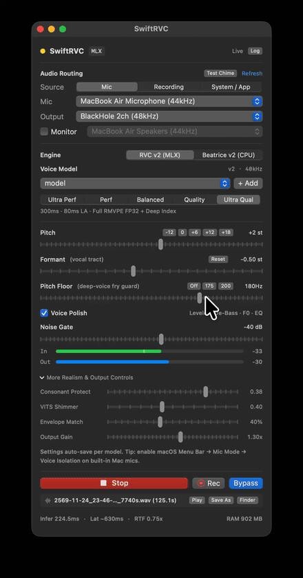

<div align="center">

# SwiftRVC

**Swiftest native macOS real-time voice changer for Apple Silicon, built for lowest M configuration (M1 8GB Macbook Air).**

[](https://github.com/Fargile/SwiftRVC)
[](https://github.com/Fargile/SwiftRVC)
[](https://github.com/ml-explore/mlx)
[](LICENSE)
[](https://github.com/Fargile/SwiftRVC)

</div>

Runs **RVC v2** on Apple MLX and optional **Beatrice v2** on native ARM-NEON behind a ~1.6 MB SwiftUI and CoreAudio app. No Electron, PyTorch, librosa, FAISS, or full Xcode required.

> **Note:** SwiftRVC was built for personal use on a base M1 8GB Mac and is **not actively maintained**, since I am working on other projects. Expect some issues, slop, and little testing on other machines. You are encouraged to fork or copy this repo and do whatever you want with it.

<div align="center">
  
</div>

## Features

- **RVC v2 on Apple MLX:** Pure-MLX ContentVec, BN-folded RMVPE, Fast YIN, and NSF-HiFiGAN with direct `.pth` loading and memory-mapped `.index` retrieval using ~6 MB RAM instead of 270+ MB.

- **Beatrice v2 on ARM-NEON:** Optional C++ bridge to `libbeatrice.a` for `2.0.0-alpha.2`, `beta.1`, and `rc.0` packs, including multi-speaker TOML packs.

- **Low memory and idle sleep:** Switching engines unloads the inactive engine immediately, and the noise gate drops GPU/CPU inference to 0% when silent.

- **3 live input sources:** Native CoreAudio mic capture with cubic 48 kHz resampling, audio/video file playback with loop, seek, quick mic sampling, and offline **Export WAV**, plus macOS 14.2+ CoreAudio Process Tap for system or per-app audio with **Mute original**.

- **Built-in live recorder:** One-click `Rec` streams converted 48 kHz WAV takes straight to `recordings/` with inline **Play**, **Save**, and **Finder** controls.

- **Voice tuning and DSP:** Pitch from `-24` to `+24` st, Formant shift, soft Pitch Floor for deep voices, Polish chain with leveler, de-bass, F0 smoothing, and EQ, plus Protect, Shimmer, Intonation, RMS Mix, Gain, and per-model auto-save in `model_settings.json`.

## Benchmarks on Base M1 8GB

Measured on a base **Apple M1 8GB MacBook Air** on 48 kHz speech audio using Activity Monitor physical memory footprint.

### RVC v2 on Apple MLX

| Preset | Block | F0 | Inference | RTF | Total Latency | RAM |
|---|---:|---|---:|---:|---:|---:|
| Ultra Perf | 80 ms | YIN + 8-bit CV | 39.4 ms | 0.49x | 137 ms | 504 MB |
| Perf | 100 ms | YIN + 8-bit CV | 49.5 ms | 0.50x | 182 ms | 502 MB |
| Balanced | 160 ms | RMVPE fp16 | 86.4 ms | 0.54x | 297 ms | 761 MB |
| Quality | 240 ms | RMVPE fp16 | 120.7 ms | 0.50x | 436 ms | 780 MB |
| Ultra Qual | 300 ms | RMVPE fp32 | 170.6 ms | 0.57x | 576 ms | 861 MB |

### Beatrice v2 on ARM-NEON

Tested with the 100-voice `2.0.0-rc.0` JVS pack on CPU at 0% GPU.

| Preset | Block | VQ | Inference | RTF | Total Latency | RAM |
|---|---:|---:|---:|---:|---:|---:|
| Ultra Perf | 20 ms | 0 | 1.6 ms | 0.08x | 59 ms | 147 MB |
| Perf | 30 ms | 1 | 2.2 ms | 0.07x | 70 ms | 147 MB |
| Balanced | 40 ms | 2 | 2.7 ms | 0.07x | 80 ms | 148 MB |
| Quality | 60 ms | 4 | 3.9 ms | 0.07x | 101 ms | 148 MB |
| Ultra Qual | 80 ms | 6 | 5.7 ms | 0.07x | 123 ms | 148 MB |

## Requirements

- Apple Silicon Mac on macOS 13+, or macOS 14.2+ for App audio capture
- Xcode Command Line Tools via `xcode-select --install`
- Python 3.11 or 3.12
- Optional: [BlackHole 2ch](https://github.com/ExistentialAudio/BlackHole) via `brew install blackhole-2ch` for your various gaming purposes.

## Install and Build

```bash
git clone https://github.com/Fargile/SwiftRVC.git
cd SwiftRVC

./setup.sh
./build.sh
open SwiftRVC.app
```

- **RVC v2 models:** Click **`+ Add`** in the app or drop `.pth` and `.index` files into `models/`.

- **For gaming purposes (Discord):** Set SwiftRVC **Output** and Discord **Input Device** to `BlackHole 2ch`, and disable Discord Noise Suppression. For App capture, allow SwiftRVC in **System Settings → Privacy & Security → Screen & System Audio Recording → System Audio Recording Only**.

### Enabling Beatrice v2

Beatrice v2 binaries and voice packs are not bundled in this repo. To enable the Beatrice v2 engine:

1. Grab the macOS `arm64` static library `libbeatrice.a` and header `beatrice.h` from [prj-beatrice/beatrice-vst](https://github.com/prj-beatrice/beatrice-vst) and put them in `beatrice/lib/`.
2. Re-run `./setup.sh` so it compiles `beatrice/libbeatrice_bridge.dylib`.
3. Download any Beatrice `2.0.0-alpha.2`, `2.0.0-beta.1`, or `2.0.0-rc.0` voice pack, such as the official 100-voice JVS pack from [prj-beatrice on Hugging Face](https://huggingface.co/prj-beatrice).
4. Switch **Engine** to **Beatrice v2** in SwiftRVC and click **`+ Add`** to import the `.zip` or `.toml`, or extract the pack folder with its `.toml` and `.bin` files straight into `beatrice_models/<pack_name>/`.
5. Restart SwiftRVC and select **Beatrice v2** in the Engine switcher.

## Forking and PRs

Feel free to copy or fork this repository and modify it however you want. I am not actively maintaining it, so forking is usually faster than waiting on reviews. If you do submit a PR, AI-assisted code is accepted as long as you test it and take responsibility for what it generated.

## License and Credits

SwiftRVC is licensed under the MIT License. See [LICENSE](LICENSE). Optional external components such as MLX base weights, Project Beatrice's `libbeatrice.a` and voice packs, and BlackHole 2ch keep their own licenses; see [THIRD_PARTY_LICENSES.md](THIRD_PARTY_LICENSES.md).


MIT License
Copyright (c) 2026 Fargile
Built with AI assistance from **Google Gemini**.